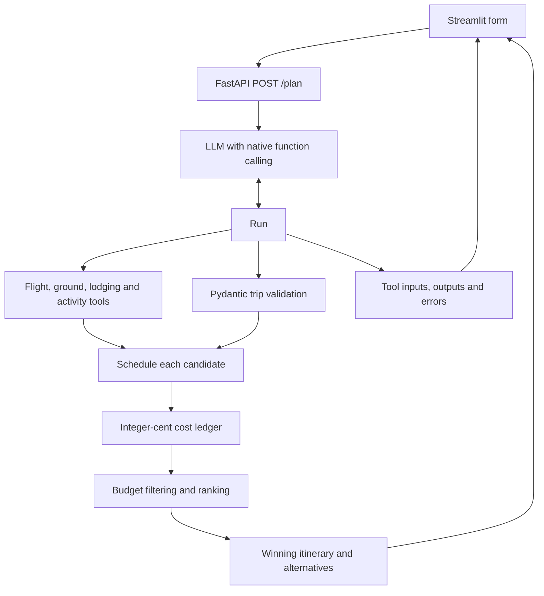

# Wayledger · M3 design and evaluation

**Stevens Institute of Technology · Track A, Build Option 1 · Individual prototype**

## Objective

A traveler needs to compare what an entire visit costs and how much of the trip can be spent at the destination. Wayledger builds a timed itinerary for each transport and lodging pairing before ranking it. A low airfare can lose once the party pays for both airport connections.

## Architecture and data flow



1. The form sends free text and optional overrides. The model extracts the route, party, dates, total budget and preferences via `set_trip`. A structured `clarify` call returns a question to the form. Edit the request or settings and submit again. Missing essentials have no defaults.
2. The model can issue multiple independent catalog calls in one reply. Explicit restrictions change the eligible tools and services. For example, rail-only trips omit the flight lookup and exclude buses. A soft preference for rail still compares all services.
3. The dispatcher checks each proposed function against the offered schema and current dependencies. Successful results and recoverable errors return to the model under the original call ID. All calculations read request-scoped inventory. The model invokes pricing and ranking, then inspects the winning itinerary.
4. The model finishes with a structured recommendation selecting a cost, time, transfer or activity fact. The application renders that fact and the ranking explanation from the chosen candidate. Model prose cannot change a price, select another winner or mark an over-budget itinerary feasible.

## Components

| Component | Responsibility |
|---|---|
| `app.py` | Natural-language form, optional overrides, loading and error states, itinerary, daily expenses, comparisons and trace |
| `travel/api.py` | Health check, planning endpoint, validated report and client-facing errors |
| `travel/request.py`, `travel/models.py` | Constraint extraction and validation, typed inventory, candidate and report contracts |
| `travel/agent.py` | Allowlisted tools, prerequisites, model interaction, error boundaries and run trace |
| `travel/catalog.py` | Reproducible service pairs, room inventory, attraction coordinates and modeled hours |
| `travel/schedule.py` | Door-to-door timing, local connections, opening windows, buffers and daily free time |
| `travel/optimize.py` | Integer-cent party ledger, complete-trip comparison, explanation and tie-breaking |

## Inventory and scheduling assumptions

The versioned local catalog is the only travel-data source for this prototype. Some attraction and station names refer to real places. Service operators, properties, grid positions, prices, opening windows and service patterns are simulated. All locations use Eastern local wall time and the example rides stay within their travel day. There are no external travel-provider requests.

Each service includes an outbound and inbound leg, origin-terminal access in both directions, and boarding time. At the destination, Manhattan grid distance approximates walking minutes. Distances through 18 units use walking, through 48 use local transit, and longer legs use a regional shuttle. These tiers supply distinct durations and per-passenger costs. Movement between identical points adds zero cost and time. A day trip uses the terminal as its base and incurs zero lodging expense.

The scheduler starts after the inbound arrival connection, and reserves the return connection and boarding buffer before selecting departure-day visits. It looks ahead to the attraction closing time and the time to return to base. It prioritizes interest matches, then the earliest reachable visit, with a stable name tie-break. It allows two distinct visits per day, inserts a fifteen-minute break after each, and preserves remaining time for meals or exploration. On longer trips the finite catalog can leave whole days free. Hotel luggage storage is assumed before check-in and after check-out.

## Constraints, costs and ranking

Dates, party size, supported routes, the budget ceiling and schedule chronology are hard constraints. Transport, hotel style, interests and time preference affect selection. Every candidate uses the requested dates. A four-day visit has three hotel nights. Rooms accommodate two people with the room count rounded up. The catalog assumes a 12% lodging tax and a $35 meal allowance per person per calendar day.

**Party total in cents** = round-trip tickets + room subtotal + terminal transfers + local movements + admissions + meals + lodging tax. Fare and transfer prices scale per person. Room costs scale per room. The fee calculation rounds once to the nearest cent. Events supply ticket, movement and admission charges. Daily presentation adds each day's meals and overnight room with tax to that day's event charges. With the catalog's whole-dollar room rates, the tax divides evenly across nights.

The optimizer enumerates up to six complete combinations per request. In cost mode the score equals total cents. In balanced and time modes the following formula produces a generalized-cost score. Lower is better.

```text
score = total_cents + travelers × (
    w × (travel_minutes − floor(destination_minutes / 4))
    + mode_penalty + hotel_penalty − 500 × interest_matches − 10 × w × visits
)
```

The weights are 10 for balanced and 50 for time priority. Travel minutes include riding, terminal access, boarding buffers and local movements. Destination minutes measure the available daily planning windows between arrival at base and the return connection, capped at the modeled end of each day. They include local visits and movement. A mismatched requested service adds 4,000 points per traveler. A mismatched hotel style adds 3,500 on overnight trips. The weights express design choices and have no claimed empirical calibration.

The rank key puts within-budget candidates first. Over-budget candidates are ordered by shortfall, then score. Remaining ties use total cents, transport mode and hotel name. If none qualify, the report explicitly says so. Optimality is limited to these enumerated schedules. The activity heuristic does not exhaustively search every visit subset or substitute cheaper meals to rescue a budget.

## Reliability and engineering decisions

The preferred stack fits a single-student implementation. Pydantic rejects unknown arguments, unrecognized city values and out-of-range constraints. Python keeps money in cents and uses Decimal at the USD input boundary. Each request has independent tool state and no shared mutable candidate cache. An empty transport or lodging set produces a visible error. Unknown calls, malformed arguments and out-of-order tools cannot set authoritative results.

The SDK uses Chat Completions with a 20-second timeout per provider attempt. The agent allows 12 model rounds by default, configurable from 1 to 30, and at most eight calls in a reply. Provider failures return a redacted error and the existing trace. Catalog tools are bounded in-memory operations. No tool contacts a live travel provider.

## M3 evaluation

The milestone demonstrates a functioning tool-calling pipeline. Inspect the Agent execution tab to follow extracted arguments, actual searches, tool sources, calculated alternatives and the final recommendation. Different hard constraints change which searches the agent can use. The API and CLI share this workflow.

| Scenario | Verification target |
|---|---|
| A, Boston | Affordable four-day trip, three hotel nights, reconciled itemized costs and chronological events |
| B, Philadelphia | Cheaper air ticket loses to bus after terminal access and other complete-trip expenses |
| C, low budget | All candidates exceed budget. Display the smallest shortfall |
| D, incomplete input | Ask for missing details before pricing |
| E, failed call | Reject invalid arguments, return errors by call ID, bound recovery and surface provider failures |

The automated suite uses the real SDK with a scripted HTTP transport. It checks the application contract and optimizer. The separately enabled live test exercises extraction and orchestration by the configured model. See README for commands. The original evidence directory contains historical fixtures from the earlier prototype. Use a fresh live run for current milestone evidence.

## Limitations

The catalog covers two Eastern-time corridors and fixed daily service. Local wall-clock schedules do not model cross-zone or overnight rides. Tickets, rooms and attraction times are simulated. Meals and transfer times are estimates. The scheduler uses a bounded visit heuristic. The model must clarify hard requirements beyond the supported fields. Extraction quality depends on the configured model.
